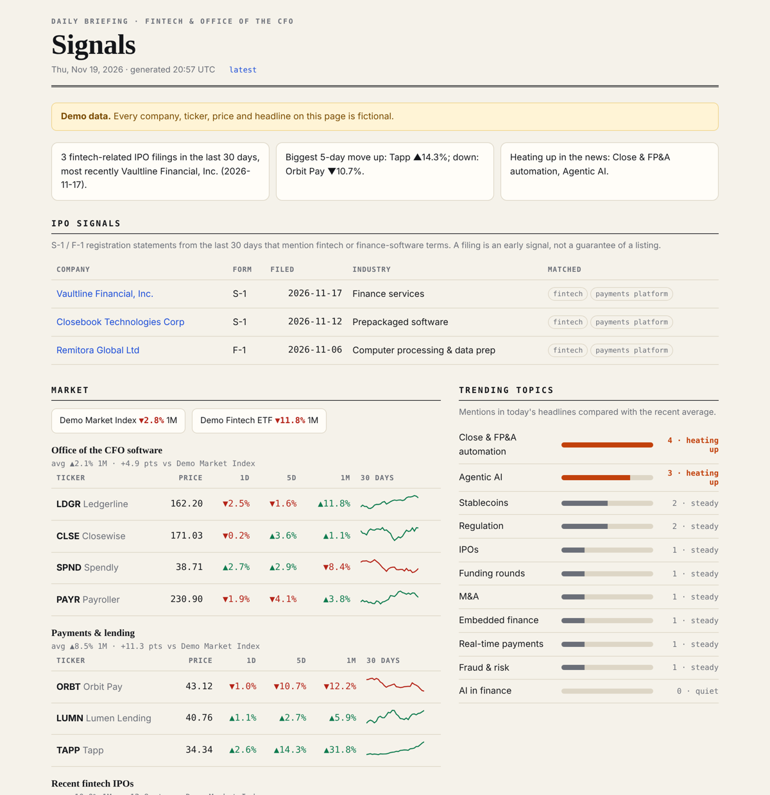
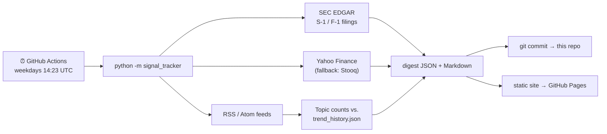

# 📡 OCFO & Fintech Signal Tracker

[](https://github.com/adij26/fintech-signal-tracker/actions/workflows/daily-digest.yml)
[](https://github.com/adij26/fintech-signal-tracker/actions/workflows/ci.yml)


**An automated daily briefing on fintech and Office-of-the-CFO software: who's filing to go public, how the sector's stocks are moving, and which topics are heating up in the news.**

Every weekday morning, GitHub Actions runs this repo on a schedule. It pulls fresh public data, writes
a digest, commits it here, and publishes it as a website. No server and no subscription.

### → [Read today's briefing](https://adij26.github.io/fintech-signal-tracker/) · [latest digest in Markdown](digests/latest.md) · [archive](digests/)


<sub>Preview rendered from the built-in demo data. Every company and number in it is fictional.</sub>

## Why I built it

I work in go-to-market for finance software, so I need to know who's raising, who's listing and
what CFOs are reading about. That usually means checking a dozen sites. This tracker checks them for me
every morning and keeps a running record, so I can also look back and see when a topic started to take off.

## What's in each digest

| Section | Source | What it tells you |
|---|---|---|
| **🚀 IPO signals** | [SEC EDGAR full-text search](https://efts.sec.gov/LATEST/search-index) | New S-1 / F-1 registration statements mentioning terms like *payments platform*, *office of the CFO* or *stablecoin*. A registration filing is the earliest public sign a company plans to list. |
| **📈 Market** | Yahoo Finance chart data, with Stooq as a fallback | A watchlist of OCFO software, payments, crypto and recent fintech IPO stocks: 1-day, 5-day and 1-month moves, distance from the 52-week high, group averages against the S&P 500, and the biggest movers. |
| **🔥 Trends** | Headlines from the feeds below | How often each topic (agentic AI, stablecoins, FP&A automation, M&A…) shows up today compared with its recent average, flagged as 🔥 heating up or ❄️ cooling. |
| **📰 Headlines** | CFO Dive, Payments Dive, Banking Dive, TechCrunch Fintech, Google News searches | Deduplicated, newest first, tagged by topic. |
| **🤖 Summary** *(optional)* | Claude API | A short lead paragraph written only from the data above. |

Everything you'd want to change lives in [`config.yaml`](config.yaml): keywords, tickers, feeds and
topics. You don't need to touch any code.

## How it works



A few design decisions:

- **One failing source never stops the digest.** Each source runs on its own. If a feed is down or a
  ticker gets delisted, the digest still publishes and a *Source health* section at the bottom says what
  was missing. The run only fails if every core source fails.
- **The repo is the database.** Each run commits its digest (`digests/`, `data/digests/`) and updates
  `data/trend_history.json`. "Heating up" is measured against those saved counts, so the tracker gets
  better at spotting trends the longer it runs.
- **Tests never touch the network.** A fixture client serves saved, fictional responses, so CI is fast
  and doesn't break when a third-party site has a bad day. The same data powers `--demo`.
- **It's polite to the SEC.** Requests identify themselves with a contact User-Agent, as
  [SEC's fair-access policy](https://www.sec.gov/edgar/searchedgar/accessing-edgar-data.htm) asks.

## Set it up on your own fork

1. **Fork** this repo.
2. **Turn on Pages:** *Settings → Pages → Source: GitHub Actions*.
3. *(Optional)* Add repository secrets under *Settings → Secrets and variables → Actions*:
   - `SEC_USER_AGENT`: your name and email, e.g. `Jane Doe jane@example.com`
   - `ANTHROPIC_API_KEY`: turns on the AI summary
4. **Run it once by hand:** *Actions → Daily digest → Run workflow*. After that it runs every weekday.

Run it locally:

```bash
pip install -e ".[dev]"
python -m signal_tracker --demo --out /tmp/demo   # offline, fictional data
python -m signal_tracker                          # live run
pytest                                            # tests
```

## Limits, honestly

- **Free data isn't perfect.** Yahoo's chart endpoint is unofficial and can change. Stooq is the
  backup, and if both miss a ticker the digest says so instead of guessing.
- **Keyword matching is blunt.** An S-1 that mentions "payments platform" once in a risk factor will
  show up. The matched terms are listed so you can judge, and blank-check SPACs are excluded by default.
- **Watchlists go stale.** Companies IPO, get acquired and change tickers. Review `config.yaml` every
  few months.
- **GitHub pauses schedules on quiet repos.** Scheduled workflows in public repos are disabled after
  60 days without activity. If that happens, re-enable it in the Actions tab.
- **Not investment advice.** This is a research and awareness tool built on public information.

## Project layout

```
config.yaml                   what to track
src/signal_tracker/
  edgar.py                    IPO filings from SEC full-text search
  market.py                   prices, returns and group comparisons
  news.py                     RSS/Atom parsing (standard library only)
  trends.py                   topic tagging and momentum
  summarize.py                optional Claude summary
  digest.py, site.py          Markdown and website output
  templates/digest.html       the site's single template
  run.py                      orchestration and CLI
tests/                        pytest suite + fictional fixtures (make_fixtures.py)
data/, digests/               written by the daily workflow
```
